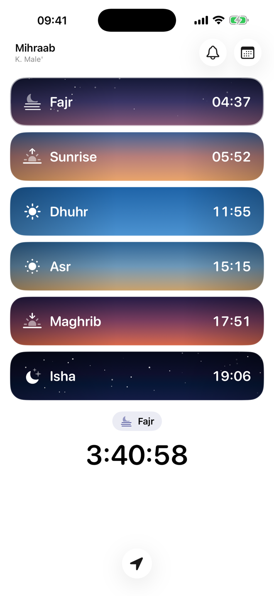
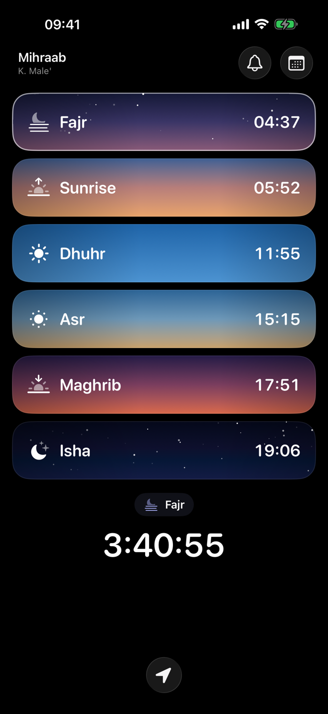
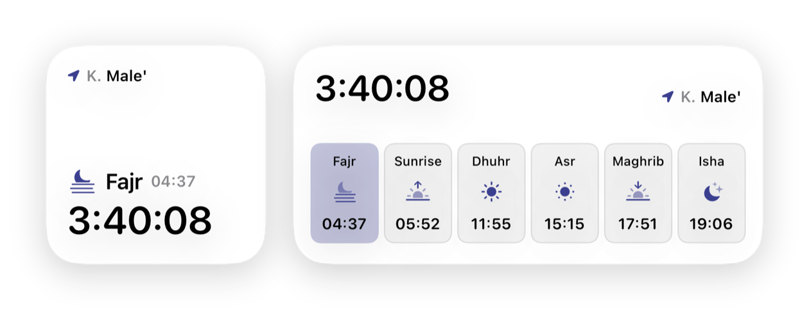
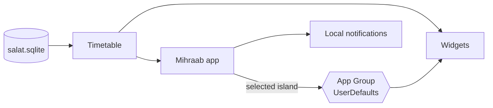

<div align="center">


# Mihraab

**Prayer times for every island in the Maldives, beautifully.**

A quiet, native iOS app that shows the day's prayers as a sky that changes with the sun,<br />
counts down to the next one, and works entirely offline.

[](#requirements)
[](https://swift.org)
[](https://developer.apple.com/xcode/swiftui/)
[](LICENSE)
[](#contributing)

[Features](#features) · [Getting started](#getting-started) · [How it works](#how-it-works) · [Contributing](#contributing)

</div>

<br />

<p align="center">
  
  &nbsp;&nbsp;&nbsp;
  
</p>

## Why Mihraab?

A *mihrab* is the niche in a mosque's wall that points the way to prayer. This app tries to do the same, quietly and without fuss.

Most prayer apps are built for the whole world and treat the Maldives as an afterthought. Mihraab is built only for the Maldives. It has every inhabited island, uses the local timetable zones and per-island minute offsets, and runs on Maldives time wherever your phone happens to be.

## Features

<table>
<tr>
<td width="50%" valign="top">

### 🌅 A sky for every prayer
Each prayer gets its own card painted in the colours of its sky: a hazy indigo dawn for Fajr, bright blue for Dhuhr, a burning sunset for Maghrib, a field of stars for Isha. The current and next prayers are highlighted as the day moves on.

</td>
<td width="50%" valign="top">

### ⏳ Live countdown
A large, rounded timer counts down to the next prayer, to the second. After Isha it rolls over to tomorrow's Fajr.

</td>
</tr>
<tr>
<td valign="top">

### 🏝️ 188 islands across 20 atolls
Search by island or atoll, browse by atoll, or tap **Use My Location** to jump to the nearest island. Location is resolved on device, only when you ask for it.

</td>
<td valign="top">

### 🔔 Time-sensitive reminders
Choose which prayers to be notified for. Reminders are scheduled locally up to 12 days ahead and arrive as Time Sensitive notifications, so Focus modes don't hide them.

</td>
</tr>
<tr>
<td valign="top">

### 📱 Home Screen widgets
A **small** widget shows the next prayer with a live timer. A **medium** widget adds the full day's timetable with the next prayer highlighted. Both refresh at every prayer boundary.

</td>
<td valign="top">

### 📅 Any day of the year
Open the calendar to look up the timetable for any date, then tap **Today** to come back.

</td>
</tr>
<tr>
<td valign="top">

### ✈️ Fully offline
The whole timetable ships inside the app as a small SQLite database. No network requests, no accounts, no analytics.

</td>
<td valign="top">

### 🌗 Made for iOS
Pure SwiftUI with Dynamic Type, VoiceOver labels, light and dark mode, and Liquid Glass on iOS 26.

</td>
</tr>
</table>

## Widgets

<p align="center">
  <picture>
    <source media="(prefers-color-scheme: dark)" srcset="Design/Screenshots/widgets-dark.png" />
    
  </picture>
</p>

The small widget keeps the next prayer and its countdown visible. The medium widget adds all six times for the day and highlights the next one. Both follow your system appearance and update on their own at every prayer.

## The six skies

| | Prayer | Sky |
|:-:|---|---|
| 🌌 | **Fajr** | Deep indigo fading to a mauve horizon, a few stars left |
| 🌄 | **Sunrise** | Cool blue warming into peach and amber |
| ☀️ | **Dhuhr** | Clear midday blue |
| 🌤️ | **Asr** | Softening blue with a golden edge |
| 🌇 | **Maghrib** | Violet to rose to ember orange |
| 🌃 | **Isha** | Near-black navy, full of stars |

Star positions come from a seeded random generator, so every sky looks the same each time you open the app.

## Getting started

### Requirements

- macOS with **Xcode 26** or later (the iOS 26 toolbar APIs need its SDK)
- **iOS 18.0+** device or simulator
- No third-party dependencies, no package manager

### Build & run

```bash
git clone https://github.com/oreofreakshake/mihraab.git
cd mihraab
open Mihraab.xcodeproj
```

Then pick the **Mihraab** scheme and press <kbd>⌘</kbd> <kbd>R</kbd>.

> [!NOTE]
> To run on a physical device, change the **Development Team** for both the `Mihraab` and `MihraabWidgetsExtension` targets. Because the App Group must be unique to your team, also update the bundle identifiers and the App Group (`group.com.yazak.Mihraab`) in:
> - `Config/Mihraab.entitlements`
> - `Config/MihraabWidgets.entitlements`
> - `Shared/SharedSettings.swift`

## How it works



The bundled `salat.sqlite` has three tables:

| Table | Purpose |
|---|---|
| `prayer_times` | Minutes after midnight for all six times, for each of the **42 timetable zones** and each day of a 366-day year |
| `islands` | Every island with its atoll, its zone, a **minute offset** from that zone, and coordinates |
| `categories` | The list of zones |

To get an island's times, Mihraab looks up its zone's row for the day and adds the island's offset. Every date is mapped onto a leap year, so 29 February always has a row. All date maths uses the `Indian/Maldives` time zone.

The app and the widget extension share the same `Shared/` sources and database, and an App Group passes the selected island between them. Picking a new island reloads widget timelines and reschedules notifications at once.

## Project structure

```
mihraab/
├── Mihraab/                    # The iOS app
│   ├── Features/
│   │   ├── Today/              # Today screen, countdown, sky cards
│   │   │   └── Sky/            # Sky gradients & seeded star field
│   │   ├── Islands/            # Atoll-grouped island picker
│   │   ├── Settings/           # Notification preferences
│   │   └── RootView.swift
│   └── Services/               # AppModel, location, notifications
├── MihraabWidgets/             # WidgetKit extension (small & medium)
├── Shared/                     # Code + data used by both targets
│   ├── Timetable.swift         # Read-only SQLite access
│   ├── Prayer.swift            # Prayer, Island, DaySchedule models
│   └── salat.sqlite            # The timetable
├── Config/                     # Entitlements & Info.plists
└── Design/
    ├── MakeIcon.swift          # Renders the app icon from code
    └── Screenshots/            # Images used in this README
```

## Roadmap

Ideas for where Mihraab could go next. Discussion and PRs are welcome.

- [ ] Dhivehi (ދިވެހި) localisation
- [ ] Lock Screen & StandBy widgets
- [ ] Live Activity for the next prayer
- [ ] Hijri date alongside the Gregorian date
- [ ] Apple Watch complication

## Contributing

Contributions of all sizes are welcome, from typo fixes to new features.

1. **Fork** the repo and create a branch: `git checkout -b feature/my-idea`
2. **Make your change**, following the existing style: two-space indents, small focused views, no third-party dependencies.
3. **Test it** on both light and dark mode, and check the widgets if you touched `Shared/`.
4. **Open a pull request** that explains what changed and why. Screenshots help a lot for UI changes.

Found an island with wrong times, or one that's missing? Please [open an issue](https://github.com/oreofreakshake/mihraab/issues) with the island name and the expected times.

## License

Mihraab is released under the [MIT License](LICENSE).

<br />

<div align="center">

<sub>If Mihraab is useful to you, consider giving it a ⭐. It helps others find it.</sub>

</div>
